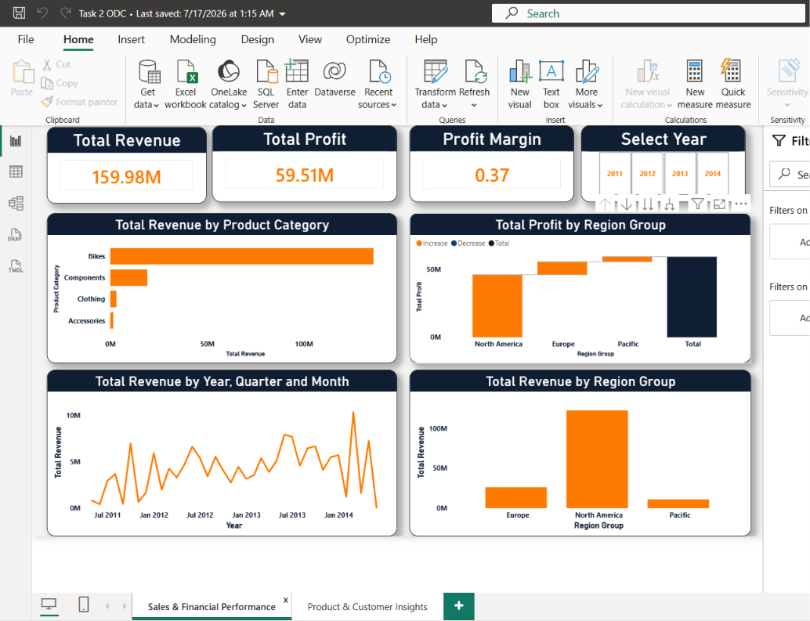

# Task 2 — Sales Performance Dashboard (Power BI)

## Objective
Build an interactive Power BI report that answers business questions about sales, products, customers and regions, from the point of view of a business owner or manager.

## Dataset
Four related tables: customers, products, regions and sales transactions.

## Workflow
1. Imported and connected all four tables
2. Cleaned and transformed the data in Power Query
3. Built a data model with relationships between the tables
4. Created 5 calculated columns and 5 DAX measures
5. Designed a multi-page report with KPIs, slicers and filters
6. Published to the Power BI Service

## Dashboard contents
**KPIs:** Total Revenue (159.98M), Total Profit (59.51M), Profit Margin (0.37)

**Visuals:**
- Revenue by product category
- Profit by region group (North America, Europe, Pacific)
- Revenue by year / quarter / month (2011–2014)
- Revenue by region group and product category
- Revenue by product status (Active vs Discontinued)
- Top customers by revenue
- Sales and profit by category (matrix)

**Slicers:** Year, Product Status

## Key findings
- Bikes generate most of the profit (about 49.3M of 59.5M total).
- Total quantity sold: 274,915 units.
- Revenue can be compared across all three region groups and by month.

## Files
- `Task_2_ODC_Dash_Board.pdf` — dashboard export
- `Data_Analysis_-_Task_2.pdf` — task brief

## Tools
Power BI Desktop, Power Query, DAX, Power BI Service

## Dashboard Overview

